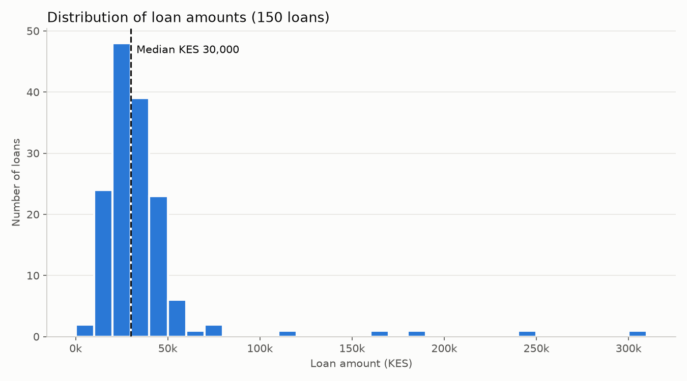

# Mombasa Microfinance: Loan Repayment Analysis

An analysis of 150 **fictional** loan records prepared ahead of a board presentation.
It answers three questions: what is a typical loan, are there unusually large or
small loans, and does loan size have anything to do with how quickly borrowers
make their first repayment.

> All data in `loans.csv` is synthetic, generated by `analysis.py` with a fixed
> random seed. It does not describe real borrowers.

## Key message for the board

**Bigger loans tend to take a little longer to get their first repayment, but loan size on its own is not a reliable way to predict when any single borrower will start paying.**

(Technical note: Pearson correlation r = 0.39; rank-based Spearman ρ = 0.34. Both point to a moderate positive relationship.)

## 1. What is a typical loan?

| Measure | Loan amount (KES) | Days to first repayment |
|---|---:|---:|
| Count | 150 | 150 |
| Mean | 36,253 | 17.7 |
| **Median** | **30,000** | **18** |
| Standard deviation | 35,331 | 6.6 |
| Minimum | 2,500 | 3 |
| 25th percentile (Q1) | 22,125 | 14 |
| 75th percentile (Q3) | 39,375 | 21 |
| Maximum | 310,000 | 40 |

**Typical loan: KES 30,000 (the median).** Half of all loans fall between
KES 22,125 and KES 39,375. The average (KES 36,253) sits higher than the median
because a few very large loans pull it up, so the median is the better figure to quote.
A typical borrower makes their first repayment after about 18 days.



## 2. Unusually large or small loans (IQR method)

A loan counts as unusual if it falls more than 1.5 × the interquartile range
beyond Q1 or Q3. For loan amounts the normal range is roughly **KES 0 to 65,250**.

**7 unusually large loans:**

| Loan ID | Amount (KES) | Days to 1st repayment | County |
|---|---:|---:|---|
| LN-0139 | 73,500 | 20 | Mombasa |
| LN-0031 | 78,500 | 30 | Taita Taveta |
| LN-0140 | 111,500 | 23 | Lamu |
| LN-0089 | 162,000 | 18 | Mombasa |
| LN-0008 | 185,000 | 31 | Tana River |
| LN-0042 | 240,000 | 25 | Kilifi |
| LN-0124 | 310,000 | 40 | Mombasa |

**No unusually small loans were flagged.** Because the lower limit works out
below zero, the IQR rule cannot flag small loans in this data. The smallest
loans (LN-0020 at KES 2,500 and LN-0103 at KES 3,000) are worth a manual look.

Repayment timing outliers (normal range 4–32 days): LN-0144 (3 days),
LN-0077 (32), LN-0099 (36) and LN-0124 (40). LN-0124, the largest loan,
is also the slowest to start repaying.

## 3. Loan size vs. days to first repayment

- Pearson r = **0.39**, Spearman ρ = **0.34**: a moderate positive link.
- In plain terms, larger loans tend to start repaying slightly later. There is a
  lot of variation, so a large loan is not automatically a slow payer.
- Correlation shows the two move together. It does not show that loan size causes the delay.

## Files

| File | Contents |
|---|---|
| `analysis.py` | Generates the data, runs every calculation, draws the chart |
| `loans.csv` | The 150 fictional loan records (`loan_id, amount_kes, days_to_first_repayment, county`) |
| `output.txt` | Full console output from the last run |
| `loan_amount_histogram.png` | Histogram of loan amounts |

## Reproduce

```bash
pip install -r requirements.txt
python analysis.py
```
